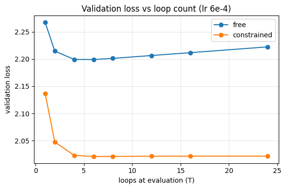
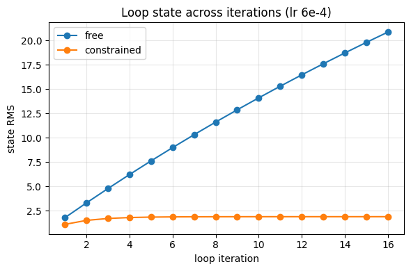
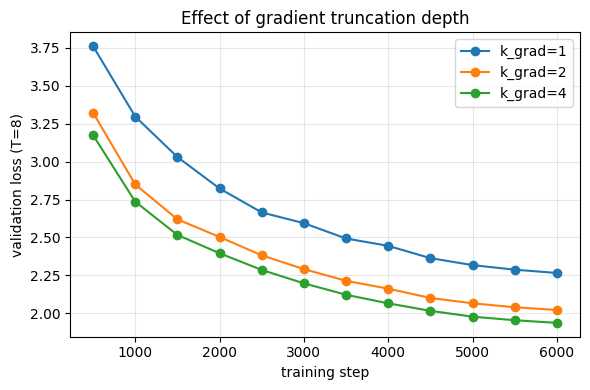

# Stability of looped language models: constrained vs unconstrained injection

Small-scale experiments on looped (recurrent-depth) language models, motivated by the stability argument in Parcae (Prairie et al., 2026). A 28.5M-parameter looped transformer is trained on TinyStories with two variants of the loop's injection step, and the two are compared on validation loss, test-time looping, and the dynamics of the loop state.

The repo also contains a second, unrelated small experiment on data-efficient expression recognition with frozen CLIP embeddings (`p2_fewshot/`).

## Summary of results

All numbers are validation loss on a fixed validation set, evaluated with a fixed number of loops T. Everything is at toy scale: about 24.6M training tokens per run, one T4 GPU.

**Stage 1: injection ablation (two seeds, lr 6e-4, 6,000 steps)**

| | Free, seed 0 / 1 | Constrained, seed 0 / 1 |
|---|---|---|
| Val loss, T = 8 | 2.201 / 2.199 | **2.021 / 2.026** |
| Val loss, T = 24 | 2.222 / 2.223 | 2.021 / 2.026 |
| Max decay `A` (peak during training) | 1.038 / 1.046 | 0.555 / 0.570 |
| Loop-state RMS at loop 16 | 20.87 / 21.06 | 1.89 / 1.84 |
| Loss spikes / non-finite losses | 0 / 0 and 0 / 0 | 0 / 0 and 0 / 0 |

- The constrained model is better by about 0.18 nats (0.180 and 0.173 in the two seeds).
- Its loss is flat from 6 to 24 loops and its loop state settles to a fixed point. The free model is best at 4 to 6 loops, degrades slightly beyond that, and its state grows roughly linearly with every loop.
- Neither model showed training instability at lr 6e-4, so the evidence is in the loop dynamics and test-time behaviour, not in divergence.




**Stage 3: gradient truncation depth `k_grad` (constrained, seed 0, lr 6e-4)**

| | k_grad = 1 | k_grad = 2 | k_grad = 4 |
|---|---|---|---|
| Val loss, T = 8 | 2.265 | 2.021 | **1.936** |
| Training time (6,000 steps) | 1,185 s | 1,462 s | 1,656 s |
| Fraction of logged steps clipped | 2.0% | 2.0% | 59% |



**Supplementary: learning rate 2e-3 (3,000 steps, seed 0)**

| | Free | Constrained |
|---|---|---|
| Val loss, T = 8 | 3.552 | 3.203 |
| Max decay `A` (peak) | 1.141 | 0.665 |
| Loop-state RMS at loop 16 | 152.75 | 14.21 |
| Spikes / non-finite | 0 / 0 | 0 / 0 |

A learning rate of 2e-3 degrades training in both models without producing spikes. It is not a clean instability test (see limitations).

The full write-up is in `report/`.

## Method

- **Data:** first 10% of the TinyStories training split, GPT-2 tokenizer. 47.2M training tokens, 0.48M validation tokens (the last 1% of the token stream).
- **Model:** 1 prelude block, 3 shared core blocks looped, 1 coda block. Width 384, 6 heads, context 256, RMSNorm, tied embeddings. Loop update `h <- A * h + Bbar`, then `h <- core(h)`, followed by a readout projection `C`.
- **Constrained injection:** `A = exp(-dt * exp(log_a))` is strictly between 0 and 1, and the input term is scaled by the same step size, `Bbar = dt * B(x)`.
- **Free injection (ablation):** `A` is a learned per-channel vector initialised at 1, with an unscaled `B`. This is a diagonal ablation, not the injection used in earlier looped models.
- **Training:** AdamW (betas 0.9/0.95, weight decay 0.1 on matrices only), 100-step warmup then cosine decay to 10%, gradient-norm clipping at 1.0, fp16 autocast, batch 16 x 256 tokens. One loop count per sequence, Poisson with mean 6 clamped to 1 to 12, and gradients through the last `k_grad` loops of each sequence only.
- **Evaluation:** 16 fixed validation batches of 16 sequences, fixed loop counts T = 1, 2, 4, 6, 8, 12, 16, 24.

## Reproduce

Requires a CUDA GPU. Each 6,000-step run takes about 25 minutes on a Colab T4.

```bash
pip install -r requirements.txt
cd p4_looped
python data.py --out_dir data                          # tokenise once
python train.py --exp stage1 --data_dir data --run_dir results
python train.py --exp stage3 --data_dir data --run_dir results
python train.py --exp stress --data_dir data --run_dir results
python plots.py --run_dir results --fig_dir ../figures
```

Each run writes `results/<name>.json` (configuration, logs every 20 steps, evaluation history, final results) and a resumable checkpoint `<name>.pt`, which is not tracked by git. Runs whose JSON already exists are skipped. The `k_grad = 2` run is the Stage 1 constrained run.

## Limitations

- **Few seeds.** The Stage 1 comparison has two seeds per condition. The stress runs and the `k_grad` runs have one seed each. Two seeds do not support a variance estimate.
- **Confounds in the Stage 1 comparison.** The constrained model also scales its input by `dt` and starts at `A` near 0.5, while the free model starts at `A = 1`. Part of the gap may come from parameterisation or initialisation. Controls (a constrained model without the `dt` factor, a free model initialised at 0.5) have not been run.
- **Clipping confound at `k_grad = 4`.** 59% of logged steps were clipped at a fixed threshold of 1.0, so the Stage 3 runs also differ in effective step size.
- **No training divergence was observed,** including at lr 2e-3. The spike counter flags sudden jumps above 1.5 times a running average, so it misses a slow plateau at a high loss.
- **Memory.** Loop counts are sampled per sequence, so a graph is built at nearly every loop step and peak memory did not change with `k_grad`. The time saving of truncation is real, the memory saving is not realised here.
- **Resumed run.** The seed 0 free run was resumed from a checkpoint at step 5000, and the data generator was reseeded at that point. Its recorded training time covers only the steps after the resume.
- **Scale.** 28.5M parameters and about 24.6M tokens test a mechanism, not the scaling laws in the paper. Evaluation at T = 16 and 24 extrapolates beyond the 1 to 12 loops used in training.
- **Validation data** comes from the same subset of TinyStories as the training data.

## Provenance

The constrained injection, the `C` readout and the per-sequence loop sampling were written from a reading of the Parcae paper and its summaries. They have not been checked line by line against the authors' reference code, and the equations should be compared with the paper before drawing conclusions about it. The scripts in `p4_looped/` are the Colab notebook cells, reorganised into modules. The numbers in this README come from the notebook runs. The scripts themselves have been syntax-checked, and a full rerun of them has not been done.

## Layout

```
p4_looped/     model.py, data.py, train.py, plots.py, notebooks/, results/
p2_fewshot/    notebook, results and README for the expression-recognition experiment
figures/       figures used in the report and this README
report/        written report
```

## Reference

Prairie et al. (2026), Parcae: Scaling Laws for Stable Looped Language Models. https://arxiv.org/abs/2604.12946
